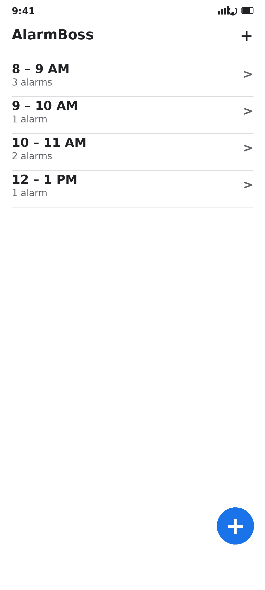
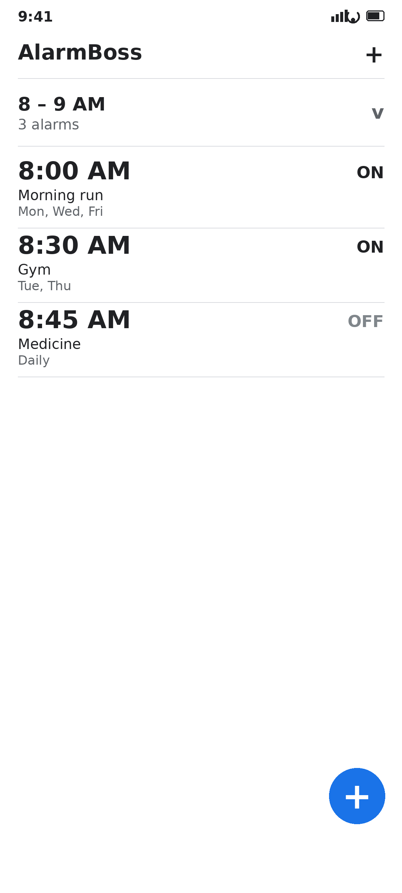
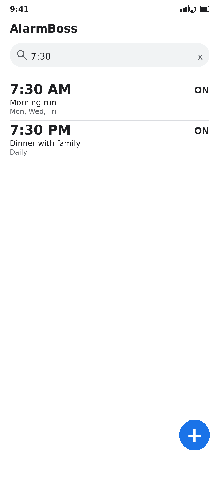
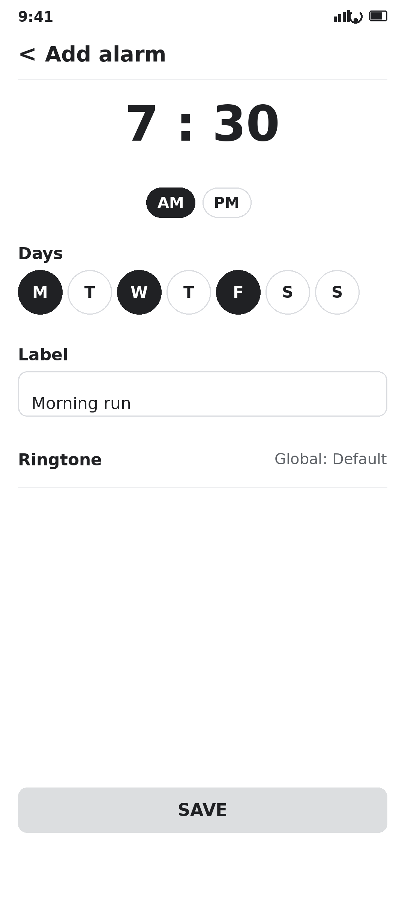
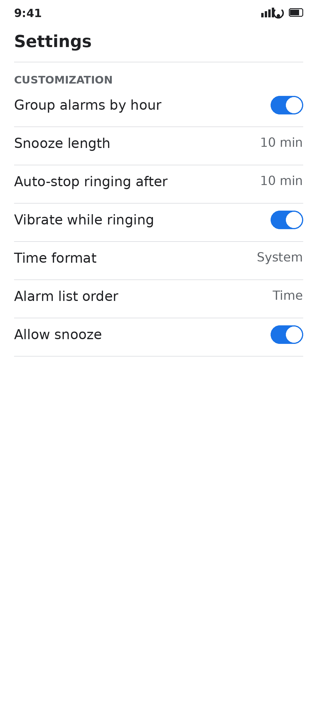
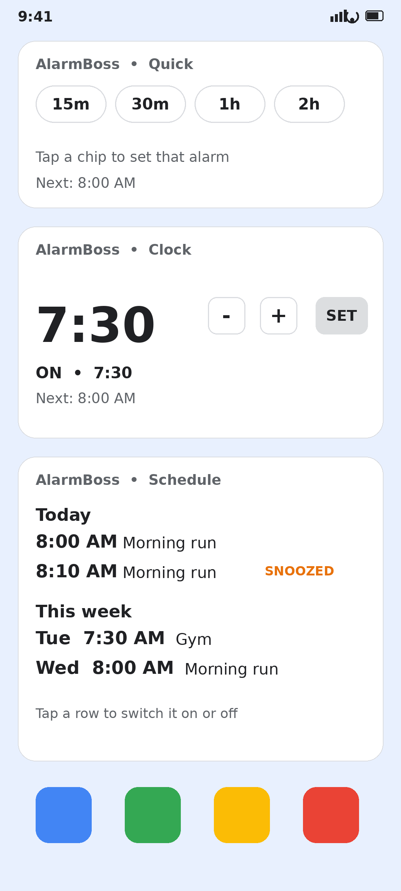
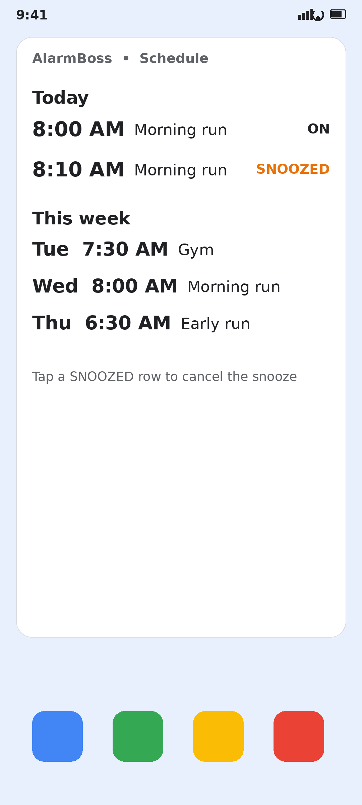
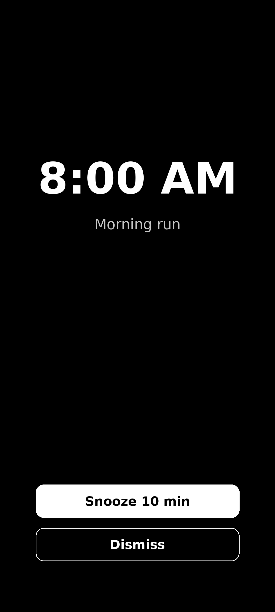

# AlarmBoss ⏰


> A fast, fully offline alarm app for Android. Search any alarm in seconds, group alarms by hour, and control everything from home-screen widgets — no account, no internet, no ads.

Stock clock apps bury your alarms in one endless list. AlarmBoss was built for the opposite problem: **set an alarm as fast as possible, find it instantly, and never create a duplicate by accident.**

## ✨ Features

### ⚡ Set an alarm in seconds
- **Search** by time, label, or day — `7:30`, `7:30 pm`, `gym`, `mon` all work, in 12h and 24h
- **Hour slots** — opening the app shows slot headers like `8 – 9 AM • 3 alarms`; tap a slot to see that hour's alarms, tap again to close it
- **Toggle-or-create, never duplicate** — setting a time that already exists just switches that alarm on instead of creating a second one
- **Quick widget** — one-tap alarms in 15m / 30m / 1h / 2h / 3h / 6h (chip count configurable)
- **Clock widget** — pick a time, press SET, and it toggles-or-creates that alarm with the global ringtone

### 🧩 Three home-screen widgets
| Widget | What it does |
|---|---|
| **Quick widget** | Duration chips (15m–6h) that toggle-or-create alarms, plus a "Next alarm" footer |
| **Clock widget** | Hour/minute steppers + SET, with an ON/OFF status line and "Next alarm" footer |
| **Schedule widget** | Your upcoming alarms for **Today** and **This week**, refreshed in real time whenever any alarm changes anywhere — tap a row to toggle it, tap a SNOOZED row to cancel the snooze, tap the title to open the app |

### 🎵 Your sound, your way
- Pick a **system tone** or **any music file on your device** — songs keep working after a reboot (persisted permission)
- A **global ringtone** is applied automatically to alarms without their own tone, and you can see it everywhere as `Global: <name>` with a Preview button
- Apply one tone to a single alarm, to several selected alarms, or to all alarms at once
- Unplayable files are refused with a clear message instead of silently falling back

### 😴 Snooze you can actually see
- Snooze length is your choice: 5 / 10 / 15 / 30 minutes (the Snooze button shows the chosen length)
- A snoozed alarm appears as a **SNOOZED** row in the schedule widget and a SNOOZED tag in the alarm list
- Tap the SNOOZED tag or row to cancel the snooze; snoozes survive a reboot; snoozing can be turned off entirely in Settings

### 🗑️ Manage in bulk
- Long-press to select one or many alarms, then **Delete** (with confirmation) or apply one ringtone to all selected
- **Delete all** in Settings (also confirmed, so no accidents)

### ⚙️ Customization
| Setting | Options | Default |
|---|---|---|
| Group alarms by hour | On / Off | On |
| Snooze length | 5 / 10 / 15 / 30 min | 10 min |
| Auto-stop ringing after | 5 / 10 / 15 / 30 min | 10 min |
| Vibrate while ringing | On / Off | On |
| Time format | System / 12h / 24h | System |
| Alarm list order | Time / Label A–Z | Time |
| Allow snooze | On / Off | On |
| Global ringtone | Any system tone or music file | System default |
| Force-max volume | On / Off (restores your volume after) | On |

### 🔔 Reliability
- Exact alarms (with an inexact fallback and an on-screen warning if exact alarms aren't permitted)
- Rings on `STREAM_ALARM` at full volume, with vibration and a full-screen lock-screen view
- One-time alarms switch off after firing; repeating alarms reschedule to their next day automatically
- All alarms — including pending snoozes — are rescheduled after a reboot

### 🔒 Privacy
- **100% offline.** The app has no `INTERNET` permission, no accounts, no analytics, no ads
- Everything lives in a local SQLite database on your own device — nothing ever leaves it

## 📸 Screenshots

> Walkthrough frames recreated in the app's v1.5 style (not photographs of a real phone screen). Real device captures will replace them when available.

| | |
|---|---|
| <br>Hour-slot view | <br>Expanded slot |
| <br>Search | <br>Add alarm |
| <br>Settings & customization | <br>Three widgets |
| <br>Schedule widget with SNOOZED row | <br>Ringing screen |

## 🎬 Demo video

<video src="https://raw.githubusercontent.com/iit2023271/AlarmBoss/main/assets/demo/AlarmBoss-Demo.mp4" controls width="360"></video>

Slot view, search, adding an alarm, widgets, the snooze flow, and the schedule widget updating — 91 seconds. The video is a recreated walkthrough, not a phone screen recording. Also attached to the [v1.5 release](https://github.com/iit2023271/AlarmBoss/releases/tag/v1.5) if you want to download it.

## 📥 Installation

1. Go to [**Releases**](https://github.com/iit2023271/AlarmBoss/releases) and download the latest APK (e.g. `AlarmBoss-v1.5.apk`)
2. Open it on your phone and allow "Install unknown apps" if asked
3. Grant the notification and exact-alarm permissions when prompted — alarms can't fire reliably without them

**Requirements:** Android 8.0+ (API 26+).

> ⚠️ Installing an **older** APK over a newer installed version fails — Android blocks downgrades and the installer reports "package invalid". Always use the latest release.

## 🚀 Usage

1. Open the app → tap **+** → set the time, days, label, and tone → Save
2. Use the **search box** to find any alarm instantly
3. Tap a **slot header** (e.g. `8 – 9 AM`) to see that hour's alarms
4. **Long-press** alarms to select several, then Delete or apply one ringtone to all of them
5. Add widgets: long-press the home screen → Widgets → AlarmBoss → choose Quick, Clock, or Schedule
6. When an alarm rings: **Dismiss** or **Snooze** — snoozed alarms show up in the Schedule widget until they ring again

## 🧩 Widgets in detail

- **Quick widget** — configurable 2/3/4 duration chips. Tapping a chip toggles-or-creates that alarm (never duplicates). Tap the footer to open the app.
- **Clock widget** — hour/minute steppers (step 1/5/15, your choice) and a 12h/24h/system format setting. SET toggles-or-creates. The status line shows `ON` / `OFF` / `No alarm at <time>` plus the next alarm, so a tap never looks dead.
- **Schedule widget** — Today (alarms still to come) and This week (next 6 days, day-prefixed rows). It refreshes instantly on every alarm change from anywhere. One honest caveat: across midnight it can be up to 30 minutes stale (the widget's 30-minute tick), fixed by the next tick or any alarm change.

## 🔐 Permissions — why each one

| Permission | Why |
|---|---|
| `SCHEDULE_EXACT_ALARM` | Fire at the exact set time |
| `POST_NOTIFICATIONS` | Show the ringing notification and widget controls |
| `RECEIVE_BOOT_COMPLETED` | Reschedule alarms (and snoozes) after a reboot |
| `VIBRATE` | Vibrate while ringing |
| `WAKE_LOCK` | Keep the phone awake while ringing |
| `FOREGROUND_SERVICE` + `FOREGROUND_SERVICE_MEDIA_PLAYBACK` | Keep the alarm sounding reliably |
| `USE_FULL_SCREEN_INTENT` | Show the full-screen ringing view over the lock screen |

There is deliberately **no** `INTERNET` permission.

## 🛠️ Building from source

No Gradle, no libraries, no dependencies — plain `aapt2` + `javac` + `d8` + `zipalign` + `apksigner`.

**Requirements:** JDK 17, Android SDK 34 (`platforms/android-34`, `build-tools/34.0.0`).

```sh
git clone https://github.com/iit2023271/AlarmBoss.git
cd AlarmBoss
./build.sh
```

`build.sh` signs the APK only if a signing keystore is present (`alarm-boss.keystore` + a `KEYSTORE_NOTE.txt` with the store/key passwords — **never committed to this repo**). Without one, it leaves an unsigned aligned APK at `build/aligned.apk` and tells you so.

## 📜 Version history

| Version | Highlights |
|---|---|
| **1.5** | Classic plain UI restored, hour-slot groups, fast scrolling, multi-delete + delete-all, explicit snooze-off, 7 new customization settings |
| **1.4** | Snoozes visible in the schedule widget (SNOOZED rows, tap to cancel, reboot-safe) |
| **1.3** | Schedule widget (Today + This week, real-time refresh) |
| **1.2** | Device-music ringtones via the file picker |
| **1.1** | Search fixes, visible global ringtone + Preview, widget settings, clock-widget status |
| **1.0** | First release: searchable alarms, dedupe toggle-or-create, global ringtone, quick + clock widgets |

Full details in [CHANGELOG.md](CHANGELOG.md). Older releases carry notes only — the APKs from early development were overwritten by later builds, so **download the latest release**.

## ❓ FAQ

**Can it import my stock Clock app's alarms?**
No — Android provides no API to read or toggle another app's alarms. AlarmBoss keeps its own alarm store, which is why everything above (search, slots, widgets) works.

**Will my alarms survive a reboot?**
Yes. Alarms and pending snoozes are rescheduled automatically on boot.

**Does it work without internet?**
Yes — it has no internet permission at all and works fully offline.

**Why did an old APK say "package invalid"?**
Android blocks installing an older version over a newer one. Use the latest release.

## 🤝 Contributing

Issues and pull requests are welcome. Two ground rules: keep the app **fully offline** and **framework-only** (no new libraries without discussion).

## 📄 License

MIT — see [LICENSE](LICENSE). Copyright © 2026 Saladi Vishnu Vardhan (Crazyboss).
